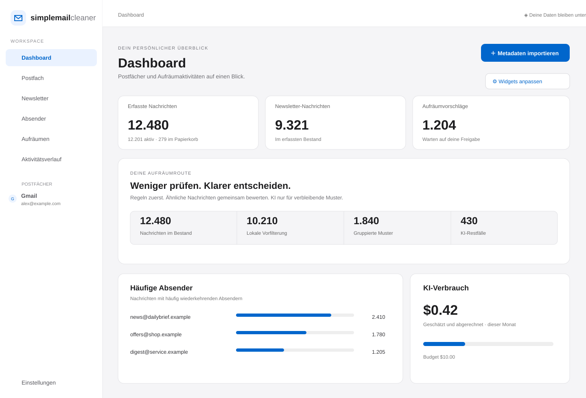
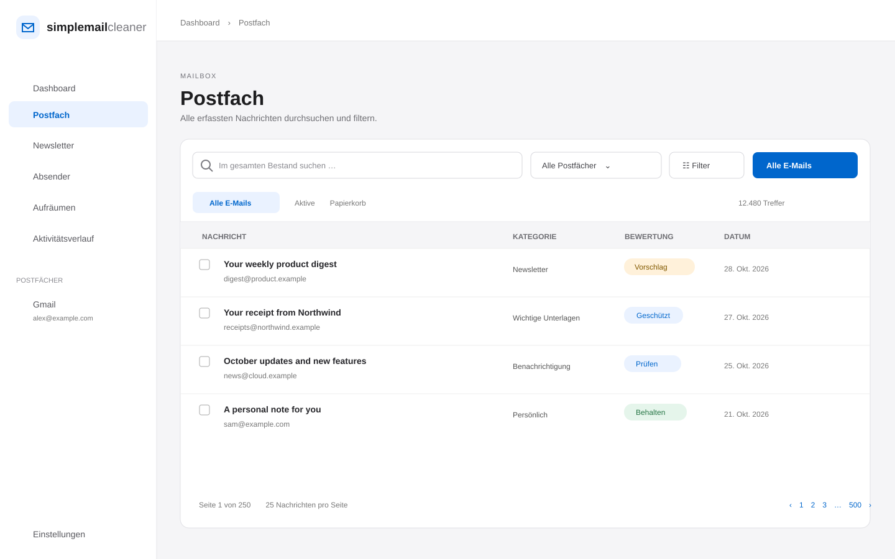
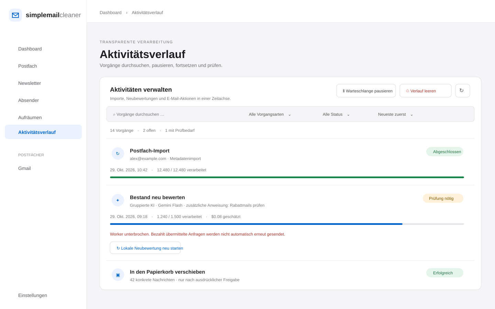

# SimpleMailCleaner

[](LICENSE)
[](https://nextjs.org/)
[](https://www.postgresql.org/)

**An open-source workspace for privacy-conscious, AI-assisted email cleanup.** SimpleMailCleaner groups newsletters and recurring senders, helps review large mailboxes, and only moves or unsubscribes messages after the user explicitly approves the exact action.

[German README](README.de.md) · [Changelog](CHANGELOG.md) · [Security policy](SECURITY.md) · [Operating status and limitations](docs/BETRIEB.md)

> **Project status:** early, self-hosted release for local and controlled multi-user testing. Provider adapters are implemented, but provider-specific end-to-end testing, OAuth verification and an independent security audit are still outstanding. This project is not a hosted SaaS service. Read the [current operating notes](docs/BETRIEB.md) before connecting a real mailbox.

## Screenshots

The previews below use fictional mailbox data; they contain no user messages or account information.

### Dashboard



### Mailbox search and review



### Activity timeline



## Features

- Dashboard with indexed-message, newsletter, cleanup-suggestion, sender, unclassified-message and AI-usage metrics. Widgets can be hidden or reordered per browser.
- Dedicated routes for Dashboard, Mailbox, Newsletters, Senders, Cleanup, Activity and Settings.
- Mailbox-wide search, server-side filtering and pagination, CSV export, message preview and manual category/recommendation controls.
- Sender and newsletter grouping, protected-sender rules and reviewed bulk cleanup by newsletter, exact sender or date.
- Optional AI-assisted re-evaluation of the existing index, saved criteria profiles, a user instruction, preview and estimated cost before a run.
- Cost-conscious pipeline: local rules → sender/subject grouping → per-user pattern cache → optional AI for unresolved patterns.
- Optional OpenRouter native batch processing. Batch retention behavior is different from the standard zero-data-retention worker and requires separate consent.
- Separate metadata, header-analysis and message-content scan modes, each with a scope and cost estimate.
- User-specific OpenRouter API keys encrypted at rest, configurable model, per-run and monthly budgets.
- Activity timeline with search, type/status filters, stable sorting, per-action results, queue pause/resume, history cleanup and safe retries for local-only operations.
- Message-by-message and bulk category/protection editing, with an explicit risk confirmation for manual protection overrides.
- Local mailbox-index purge and irreversible account deletion. Purging the local index does not change messages at the mail provider.
- Protected-message safeguards, explicit immutable action selections, version checks and a separate approval step before provider mutations.
- Newsletter unsubscribe only through verified RFC 8058 one-click headers. No form filling, login-based unsubscribe or final provider-side deletion.
- Demo access is opt-in. Until a user chooses the demo or signs in, the app does not show fictional mailbox data as if it were their account.

## Supported providers

| Provider | Connection | Notes |
| --- | --- | --- |
| Gmail | Gmail API and OAuth | Requires a Google OAuth client; public use may require Google verification and security review. |
| Outlook / Microsoft 365 | Microsoft Graph and OAuth | Requires a Microsoft OAuth app and any applicable tenant consent. |
| T-Online | IMAP over TLS | Use a separate password for mail programs. |
| Yahoo | IMAP over TLS | Use a Yahoo app password. |
| Proton Mail | Local Proton Mail Bridge plus connector | Requires an eligible Proton plan, a running Bridge and the local connector. |

Adapter support is not provider certification. IMAP trash actions require an identifiable Trash folder and safe MOVE/UIDPLUS support; unsafe COPY/DELETE fallback is not used. Review [provider setup](docs/EINRICHTUNG.md) and [operational limitations](docs/BETRIEB.md).

## Analysis modes and cost controls

| Mode | Data sent / scope |
| --- | --- |
| Metadata import | Sender, subject, date and mail/list flags. No AI call; up to 20,000 messages per import. |
| Header analysis | Sender, subject and date sent to the selected model; up to 20,000 messages per scan, with local filtering, grouping and cache reuse. |
| Re-evaluate indexed mail | Local rules first, then grouped sender/subject patterns; AI is optional and only receives unresolved metadata groups. |
| Message-content scan | Text excerpts are a separate, explicit mode limited to 500 messages. Attachments are not analyzed. |

Before an AI run, the app shows the selected scope, local decisions, unresolved patterns, request count and an estimate. Actual charges depend on the selected model, provider routing and tokenization; estimates are not guarantees. Sender addresses and subjects may themselves contain sensitive information. A worker by itself does not reduce token usage—local filtering, grouping and cache hits do.

Standard worker requests ask OpenRouter for zero data retention and deny data collection. Native batch jobs have a different retention model and require a separate opt-in. Stopping a batch locally may not stop work already accepted by the remote provider. See [analysis and cost details](docs/ANALYSEARTEN.md) and [cleanup pipeline](docs/AUFRAEUMPIPELINE.md).

## Quick start without Docker

Requirements: Node.js 22.14+, npm and PostgreSQL 17+.

```bash
git clone https://github.com/xFlayZ/SimpleMailCleaner.git
cd SimpleMailCleaner
npm ci
npm run setup
```

1. Create a dedicated PostgreSQL database.
2. Configure `DATABASE_URL` and `APP_URL=http://localhost:3000` in `.env`. The migration creates tables and the restricted `smc_tenant` role; the database user needs the required migration privileges.
3. Run database migrations and start the web app and worker in separate terminals:

   ```bash
   npm run db:migrate
   npm run dev
   npm run worker
   ```

4. Open `http://localhost:3000`. Register an account or choose **Zum Demo Zugang** to explore fictional data.

For Docker Compose, see [deployment and operation](docs/BETRIEB.md). OAuth redirect URIs, environment variables, provider prerequisites and the Proton connector are documented in [setup](docs/EINRICHTUNG.md).

### OAuth setup at a glance

For Gmail and Outlook, create an OAuth application with the exact callback URLs and scopes listed in `docs/EINRICHTUNG.md`, then set the corresponding client ID and secret in `.env`. Restart the app after changing environment variables. A production deployment must use HTTPS and provider-approved redirect URIs. Do not commit `.env`, mailbox credentials, OAuth secrets or OpenRouter keys.

## Application routes

| Route | Area |
| --- | --- |
| `/dashboard` | Overview and configurable widgets |
| `/mailbox` | All indexed messages, search and filters |
| `/newsletter` | Newsletter groups and unsubscribe review |
| `/senders` | Recurring senders and sender protection |
| `/cleanup` | Review and cleanup suggestions |
| `/activity` | Jobs, action history and results |
| `/settings` | Mailboxes, OpenRouter and account controls |
| `/login` | Sign in or register |

The root route `/` redirects to `/dashboard`.

## Safety model

- AI creates recommendations; it never independently deletes or unsubscribes.
- Provider mutations require a separate approval of a frozen list of message IDs and versions.
- Trash actions move messages to the provider's Trash where supported; they do not permanently delete them.
- Unsubscribe and trash are separate actions. Unsubscribe does not remove existing messages.
- Message content is not fetched for metadata-only analysis. Content analysis requires its own explicit confirmation.
- Tenant rows use PostgreSQL row-level security. User API keys are encrypted per user and are not returned to the UI after saving.
- Local index purge, provider mailbox disconnect and full account deletion are different controls; none of them sends delete commands for messages at the provider.

Read the full [security policy](SECURITY.md). Do not use this early release with a mailbox you cannot afford to lose access to.

## Development

```bash
npm run typecheck
npm test
npm run test:integration
npm run test:reviews
npm run test:bulk
npm run test:controls
npm run test:review-api
```

Integration scripts use synthetic users and fake provider adapters; they should not be pointed at real mail accounts. See [contributing](CONTRIBUTING.md).

## License

SimpleMailCleaner is licensed under the [MIT License](LICENSE).
